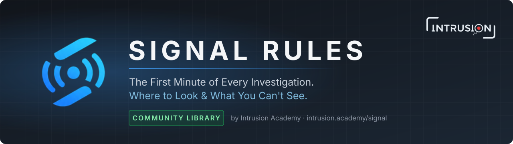

<p align="center">
  <a href="https://intrusion.academy/signal"></a>
</p>

<p align="center">
  <a href="https://intrusion.academy/signal"></a>
  <a href="https://intrusion.academy/signal/doc/latest/rules-first-rule"></a>
  <a href="#license"></a>
</p>
<p align="center">
  
  
  
  
  
  
</p>

**Signal Rules** is the community rule library of [Signal](https://intrusion.academy/signal),
a Windows DFIR survey tool by Intrusion Academy. Responders write rules here,
test them on real hosts and share them. Every rule is reviewed before it is
merged, and every rule is free to use with any edition of Signal.

> **Write your first rule:** [intrusion.academy/signal/doc/latest/rules-first-rule](https://intrusion.academy/signal/doc/latest/rules-first-rule)<br>
> **Download Signal:** [intrusion.academy/signal](https://intrusion.academy/signal)

<br>

## Contents

1. [How it fits together](#how-it-fits-together)
2. [Use the rules](#use-the-rules)
3. [What is in here](#what-is-in-here)
4. [Contribute a rule](#contribute-a-rule)
5. [Getting help](#getting-help)
6. [License](#license)

<br>

## How it fits together

This repository holds rules only. Signal itself is a separate executable.

| Part | What it does | Where to get it |
|---|---|---|
| **Signal** (`signal.exe`) | Surveys a Windows host in about a minute and runs its built-in rules and yours. Read-only. | [intrusion.academy/signal](https://intrusion.academy/signal) |
| **Signal Rules** | Rules written and tested by the community, run beside the built-in ones with `-rules`. | This repository |
| **Signal Console** | Imports the run files of all hosts. Its Rules page shows each rule file the hosts loaded. | [Signal Console](https://github.com/intrusion-academy/Signal-Console) |
| **Documentation** | How a rule works, its syntax, testing and tuning. | [intrusion.academy/signal/doc/latest](https://intrusion.academy/signal/doc/latest) |

<br>

## Use the rules

**Step 1. Get the rules.** Clone the repository, or download it as a ZIP from the green **Code** button.

```
git clone https://github.com/intrusion-academy/Signal-Rules.git
```

**Step 2. Check them** with your copy of Signal. A rule that fails a test does not run.

```
signal rules -check -rules .\Signal-Rules\rules
```

**Step 3. Run them** beside the built-in rules, on one host or from a share for the whole fleet.

```
signal live -all -rules .\Signal-Rules\rules
signal live -all -rules \\server\signal$\rules -o \\fileserver\signal-runs\
```

Keep only the rules you want: `-rules` reads every `*.json` and `*.pack` file in the folder.

> **Antivirus.** A rule that names an attack tool contains the text antivirus products look for, so an on-access scanner may quarantine the plain `.json`.
> Pack the folder first with `signal rules -pack -rules <folder>` (it writes a `.pack` beside each `.json`); `-rules` reads either form.
> Packing is not secrecy: the format is plain compressed JSON, and `signal rules` prints every rule in full.

<br>

## What is in here

```
rules/
  executions-netsh-helper-added.json    one file per rule or per topic
  ...
```

- Every file is a JSON list of rules in Signal's own format (the same as the built-in rules).
- File names start with the module, in lower case: `executions-`, `persistence-`, `logons-`.
- `rules/` is flat: Signal reads one folder, not its sub-folders.

<br>

## Contribute a rule

Contributions are welcome. A good rule finds something that is suspicious in itself, and stays quiet on a clean host.

1. **Write and test it.** Every required key, the three texts (`detail`, `impact`, `focus`), at least one test it must match and one look-alike it must not.
2. **Run the check.** `signal rules -check -rules <your folder>` must pass.
3. **Tune it.** Run it on clean hosts and add each false positive as a look-alike test.
4. **Open a pull request.** Say what it detects, why it is suspicious, which hosts it was tuned on, and its known false positives.

Read [CONTRIBUTING.md](CONTRIBUTING.md) for the format, the review checklist and how a rule is reviewed.
No rule in mind? Report a false positive or ask for a rule in [Issues](../../issues).

<br>

## Getting help

| Need | Where |
|---|---|
| How rules work, syntax, testing | [Documentation](https://intrusion.academy/signal/doc/latest/rules-how-they-work) |
| A rule fires on something benign | [Report a false positive](../../issues/new/choose) |
| A detection you would like to see | [Ask for a rule](../../issues/new/choose) |
| A rule that could harm a host or leak data | Privately, as described in [SECURITY.md](SECURITY.md) |
| Signal itself, editions, training | [intrusion.academy/signal](https://intrusion.academy/signal) |

<br>

## License

The rules are released under the [MIT License](LICENSE): use them, change them and share them, at work or anywhere else.
By opening a pull request you agree that your rule is released under the same license.
Signal itself is not part of this repository and has its own license.

<br>

<p align="center">
  <a href="https://intrusion.academy">
    <picture>
      <source media="(prefers-color-scheme: dark)" srcset=".github/assets/intrusion-academy-dark.png">
      
    </picture>
  </a>
</p>
